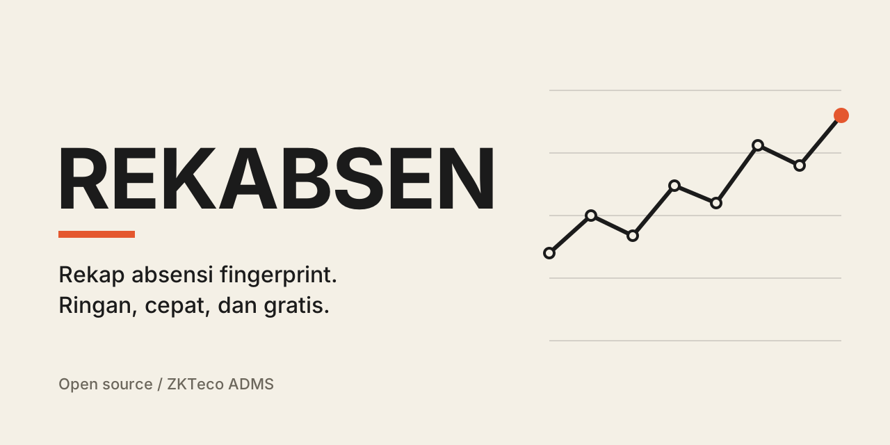

# REKABSEN

<div align="center">
  

  Receive attendance data directly from ZKTeco devices, monitor attendance in real time, and export reports to Excel. Simple, lightweight, and hassle-free.
</div>

---

## Why REKABSEN?

Many attendance management applications are bloated, expensive, or require complicated setups. REKABSEN was built as a simple, lightweight, and free alternative that anyone can use.

- **Lightweight.** Pure Python backend and vanilla JavaScript frontend. No React, Vue, or other heavy frameworks.
- **Ready to run.** Uses SQLite by default, so no database installation is required.
- **Flexible.** Need to scale up? Simply switch to MySQL.
- **Real-time.** The dashboard updates automatically whenever new attendance data is received.
- **Reporting made easy.** Export attendance reports to Excel (XLSX) with just one click.
- **Free and open source.** Free to use, study, modify, and develop.

---

## Key Features

| | |
| --- | --- |
| 🔌 **Plug and Play with ZKTeco** | Compatible with ZKTeco attendance devices using the ADMS protocol |
| ⚡ **Real-time Dashboard** | Monitor attendance instantly without manually refreshing the page |
| 📊 **Interactive Charts** | Lightweight data visualization using SVG charts |
| 📁 **Excel Export** | Generate reports ready for printing and sharing |
| 🔐 **Secure Authentication** | Password hashing and server-side session management |
| 🎨 **Multiple Themes** | Choose between Modern or nostalgic Windows 95-inspired interfaces |
| 🕒 **WIB Timezone Support** | Configured for Indonesia (UTC+7) |

---

## Technology Stack

- **Backend:** Python + `http.server`
- **Database:** SQLite (default) / MySQL (optional)
- **Frontend:** HTML5, CSS3, Vanilla JavaScript
- **Real-time Communication:** Server-Sent Events (SSE)
- **Excel Export:** openpyxl (XLSX)
- **UI:** Font Awesome 6.7.2 + Modern and Windows 95 themes

---

## Quick Start

```bash
curl -fsSL https://rekabsen.drkforest.site/instal.sh | bash
```

Open `http://localhost:8080` in your browser, and you're ready to go! 🎉

> `mysql-connector-python` is only required if you choose to use MySQL.

---

## Who Is It For?

- Schools and universities
- Offices and small businesses
- Factories and warehouses
- Communities and organizations
- Anyone looking for a free and simple attendance management solution

---

## Contributing

REKABSEN is open to everyone. Have an idea, found a bug, or want to contribute a new feature?

1. Fork this repository.
2. Create a new branch (`git checkout -b awesome-feature`).
3. Commit your changes.
4. Push your branch and open a Pull Request.

Issues, feedback, and suggestions are always welcome.

⭐ **Give this project a star if you find it useful!**

---
